# Azure Active Directory Lab — Windows Server Administration & Security

## Project Overview

This project demonstrates the deployment and administration of an Active Directory environment hosted in Microsoft Azure. Using Windows Server 2022 and Windows 11 virtual machines, I configured a domain controller, managed domain users and computers, automated account creation with PowerShell, and performed common IT support and security troubleshooting tasks.

The lab simulates an enterprise IT environment where administrators manage employee identities, enforce account security policies, troubleshoot authentication issues, and monitor Windows security events.

## Technologies Used

- Microsoft Azure — Virtual Machines, Virtual Networks, and Network Interfaces
- Windows Server 2022 — Domain Controller (DC-1)
- Windows 11 Pro — Domain-Joined Workstation (Client-1)
- Active Directory Domain Services (AD DS)
- Active Directory Users and Computers (ADUC)
- DNS
- Group Policy Management Console (GPMC)
- Windows PowerShell ISE
- Windows Event Viewer
- Remote Desktop Protocol (RDP)

## Lab Objectives

1. Deploy and configure a Windows Server domain controller in Azure.
2. Join a Windows 11 workstation to the Active Directory domain.
3. Create and manage organizational units, domain users, and security groups.
4. Automate bulk employee account creation using PowerShell.
5. Configure account lockout policies through Group Policy.
6. Troubleshoot locked and disabled user accounts.
7. Investigate failed authentication attempts using Windows Event Viewer.

## Project Phases

### Phase 1 — Azure Infrastructure & Active Directory Deployment

Deploy Azure virtual machines, configure networking and DNS, install Active Directory Domain Services, create a new forest, and join a Windows 11 workstation to the domain.

### Phase 2 — User Administration & PowerShell Automation

Create administrative accounts, configure organizational units and security group memberships, manage Remote Desktop access, and automate employee account provisioning with PowerShell.

### Phase 3 — Account Security & Troubleshooting

Configure Group Policy account lockout settings, simulate account lockouts, reset passwords, disable and re-enable user accounts, and investigate authentication failures using Windows Event Viewer.

## Lab Environment

| Component | Configuration |
|---|---|
| Cloud Platform | Microsoft Azure |
| Domain Controller | DC-1 — Windows Server 2022 |
| Client Workstation | Client-1 — Windows 11 Pro |
| Active Directory Domain | mydomain.com |
| Virtual Network | Active-Directory-VNet |
| Resource Group | Active-Directory-Lab |
| Employee Organizational Unit | _EMPLOYEES |
| Administrator Organizational Unit | _ADMINS |

## Skills Demonstrated

- Windows Server administration
- Active Directory user and computer management
- DNS and network troubleshooting
- PowerShell scripting and automation
- Group Policy configuration
- Account provisioning and access management
- Password resets and account lockout troubleshooting
- Windows security event log analysis
- Remote Desktop configuration
- IT support troubleshooting and documentation


---

## Phase 1 — Azure Infrastructure & Active Directory Deployment

### 1. Create the Azure Resource Group

I began by creating a resource group named `Active-Directory-Lab` in Microsoft Azure. This resource group served as a centralized location for organizing and managing the infrastructure required for the lab.

**Purpose:** Resource groups allow administrators to organize related Azure resources and manage their lifecycle.


### 2. Configure the Virtual Network

I created an Azure virtual network named `Active-Directory-VNet` to provide network connectivity between the domain controller and the Windows 11 client workstation.

Both virtual machines were deployed within the same virtual network to support communication required for domain authentication, DNS resolution, and Active Directory management.

**Purpose:** A properly configured virtual network allows domain-joined computers to communicate with the domain controller.


### 3. Deploy the Domain Controller

I deployed a Windows Server 2022 virtual machine named `DC-1` to serve as the domain controller for the Active Directory environment.

The server was configured within the existing resource group and virtual network.

**Purpose:** The domain controller provides centralized authentication, identity management, and domain services for the environment.

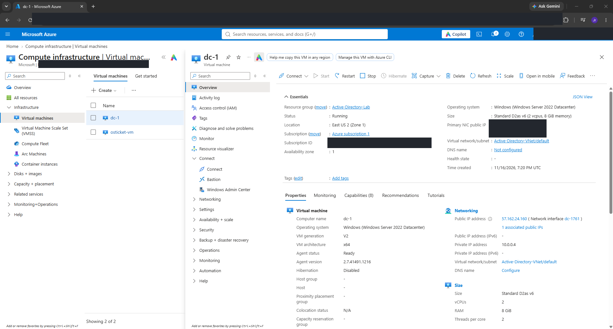

### 4. Deploy the Windows 11 Client

I deployed a Windows 11 Pro virtual machine named `Client-1` in the same Azure resource group and virtual network as `DC-1`.

This workstation was used to test domain connectivity, user authentication, account management, and troubleshooting scenarios.

**Purpose:** The client workstation simulates an employee computer within an enterprise Active Directory environment.


### 5. Configure the Domain Controller's Private IP Address

I configured the network interface associated with `DC-1` to use a static private IP address of `10.0.0.4`.

**Purpose:** Assigning a static private IP ensures that the domain controller maintains a consistent network address for DNS resolution and domain authentication.

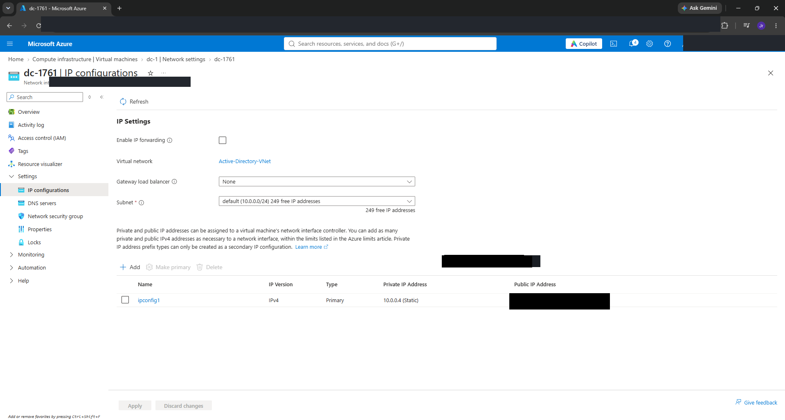


### 6. Configure Client DNS Settings

After configuring the domain controller's static private IP address, I updated the DNS settings for the Windows 11 client workstation.

I configured `Client-1` to use the private IP address of `DC-1` (`10.0.0.4`) as its DNS server.

**Purpose:** Active Directory relies on DNS to locate domain controllers and other domain services. Pointing the client to the domain controller allows it to resolve the Active Directory domain.

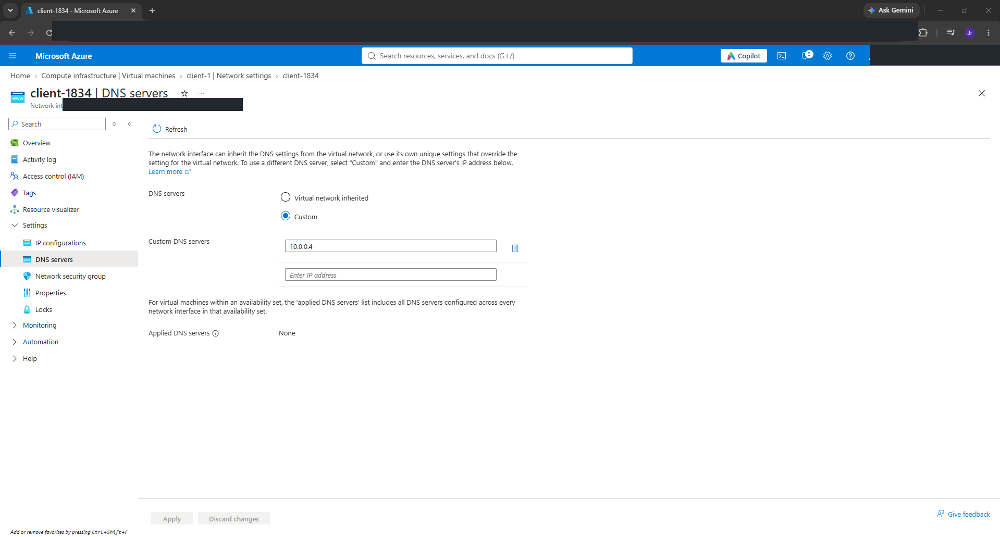

### 7. Test Network Connectivity

I connected to `Client-1` using Remote Desktop and opened PowerShell.

I used the `ping` command to test communication with the domain controller:

```powershell
ping 10.0.0.4
```

The test confirmed that the client workstation could communicate with the domain controller over the Azure virtual network.

**Purpose:** Testing network connectivity helps identify potential communication issues before attempting to join a workstation to a domain.

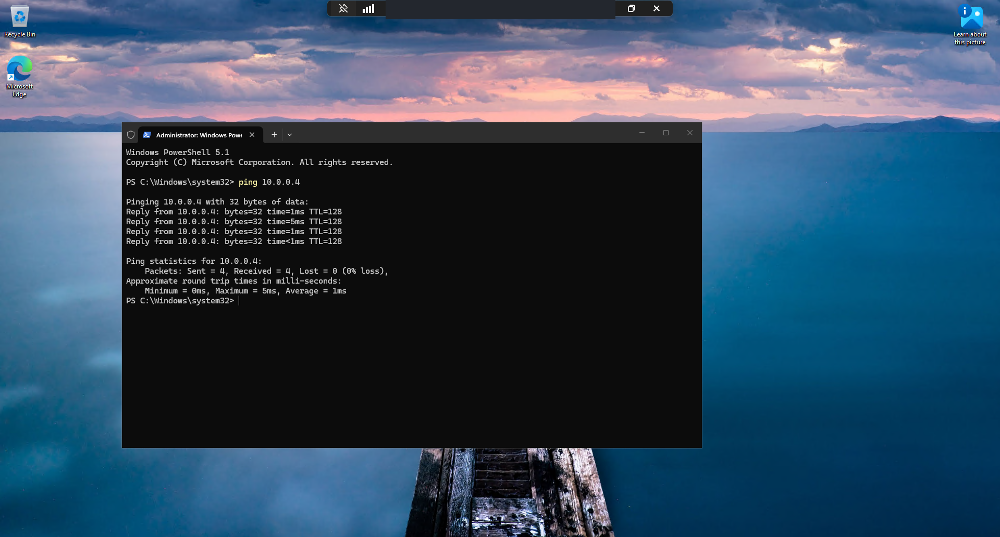

### 8. Verify DNS Configuration

I ran the following command on `Client-1`:

```powershell
ipconfig /all
```

I verified that the DNS server listed in the network configuration matched the private IP address of `DC-1`.

**Purpose:** Verifying DNS settings helps ensure the workstation can locate the domain controller for domain authentication.


### 9. Install Active Directory Domain Services

I connected to `DC-1` and installed the Active Directory Domain Services (AD DS) server role using Windows Server Manager.

AD DS provides centralized identity management, authentication, and authorization for computers and users in a Windows domain environment.

**Purpose:** Installing AD DS prepares the Windows Server virtual machine to function as a domain controller.


### 10. Promote the Server to a Domain Controller

After installing AD DS, I promoted `DC-1` to a domain controller.

I created a new Active Directory forest with the domain name:

`mydomain.com`

After completing the configuration and restarting the server, the domain controller was ready to manage domain users, computers, and security policies.

**Purpose:** Promoting the server establishes the Active Directory domain and enables centralized management of domain resources.


---

## Phase 2 — Active Directory User Administration & PowerShell Automation

### 11. Create Organizational Units

Using Active Directory Users and Computers (ADUC), I created two organizational units:

- `_EMPLOYEES` — For standard employee accounts.
- `_ADMINS` — For administrative accounts.

Organizational units provide a structured way to organize and manage Active Directory objects.

**Purpose:** Separating employee and administrator accounts helps maintain an organized directory and supports administrative delegation and policy management.

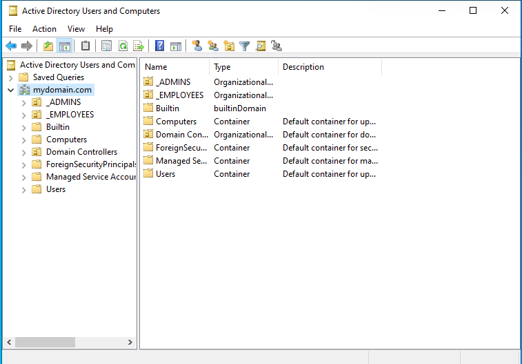

### 12. Create a Domain Administrator Account

I created a user account named `jane_admin` for Jane Doe and placed it in the `_ADMINS` organizational unit.

I added the account to the `Domain Admins` security group.

After configuring the account, I signed out of `DC-1` and signed back in using the domain administrator credentials.

**Purpose:** This exercise demonstrates user account creation, security group membership management, and privileged domain administration.

**Security Note:** Domain Admins membership provides extensive privileges and should be restricted to authorized administrators. In production environments, administrators should use least-privilege access and separate privileged accounts from everyday user accounts.

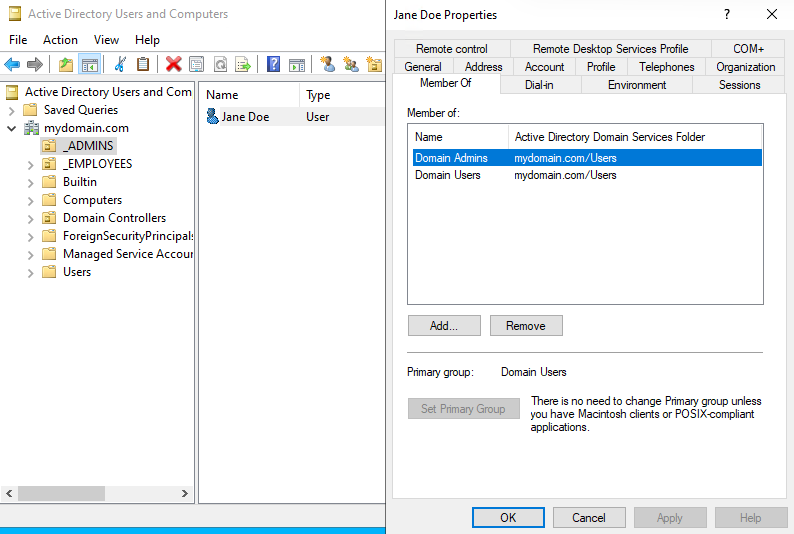

### 13. Join Windows 11 to the Active Directory Domain

I connected to `Client-1` using the local administrator account and joined the workstation to:

`mydomain.com`

After entering authorized domain credentials, I restarted the workstation to complete the domain join.

**Purpose:** Domain joining allows a workstation to authenticate users through Active Directory and participate in centralized domain management.

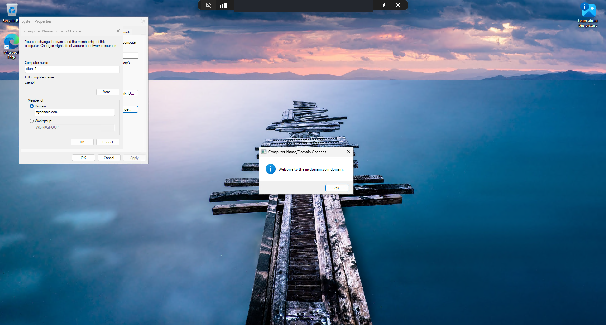

### 14. Verify the Computer in Active Directory

After joining `Client-1` to the domain, I returned to `DC-1` and opened Active Directory Users and Computers.

I verified that the client workstation appeared as a computer object in the domain.

**Purpose:** Verifying the computer object confirms that the workstation has successfully joined the Active Directory environment.

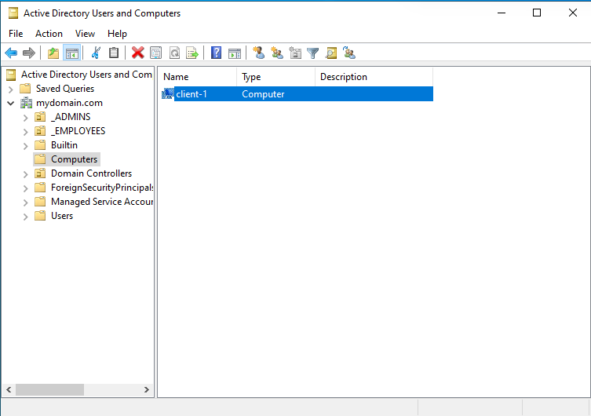

### 15. Configure Remote Desktop Access for Domain Users

I signed in to `Client-1` using the domain administrator account and configured Remote Desktop access.

For the lab, I added the `Domain Users` group to the workstation's Remote Desktop access permissions.

This allowed me to test authentication using standard domain user accounts.

**Purpose:** This exercise demonstrates how Windows administrators configure and troubleshoot remote access permissions for domain users.

**Security Note:** Granting Remote Desktop access to all domain users was performed for testing purposes. In production environments, access should be limited to explicitly authorized users or security groups.

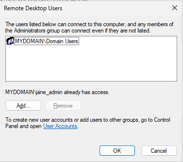

### 16. Automate Active Directory User Creation with PowerShell

To practice account provisioning and administrative automation, I used Windows PowerShell ISE on `DC-1`.

I executed a PowerShell script that generated employee user accounts in Active Directory.

The script created accounts within the `_EMPLOYEES` organizational unit.

**Purpose:** PowerShell automation can reduce repetitive administrative work, improve consistency, and support large-scale user provisioning.

**Script Reference:**
[Josh Madakor — Active Directory PowerShell User Creation Script](https://github.com/joshmadakor1/AD_PS/blob/master/Generate-Names-Create-Users.ps1)

**Security Note:** The script was used in an isolated lab environment. Example passwords and credentials should never be reused in production or included in public repositories.


### 17. Verify Bulk-Created Employee Accounts

After executing the PowerShell script, I opened Active Directory Users and Computers.

I navigated to `_EMPLOYEES` and verified that the generated employee accounts were present.

**Purpose:** This verification demonstrates successful automated user provisioning and confirms that the accounts were created in the intended organizational unit.


### 18. Test Domain User Authentication

I selected one of the employee accounts created through PowerShell and attempted to sign in to `Client-1`.

The login was successful, confirming that the account could authenticate against the Active Directory domain.

**Purpose:** Testing domain authentication verifies that the newly provisioned accounts are functional and can access an authorized domain-joined workstation.


---

## Phase 3 — Account Security, Troubleshooting & Event Monitoring

### 19. Configure Account Lockout Policy Using Group Policy

I opened the Group Policy Management Console (GPMC) and configured account lockout settings for the Active Directory environment.

The lab used the following settings:

| Policy Setting | Configured Value |
|---|---|
| Account lockout threshold | 5 invalid logon attempts |
| Account lockout duration | 30 minutes |
| Reset account lockout counter after | 10 minutes |

These settings were used to simulate an organization's password security controls.

**Purpose:** Account lockout policies help protect user accounts against repeated unauthorized password attempts.

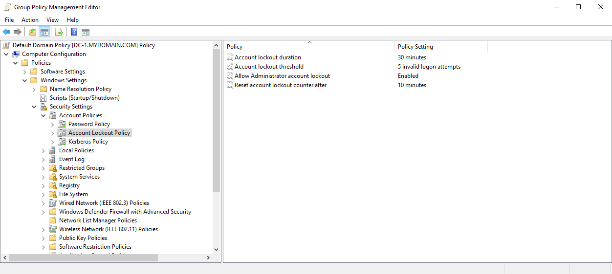

### 20. Simulate a Domain User Account Lockout

To test the account lockout policy, I attempted to sign in to `Client-1` using an employee account with an incorrect password multiple times.

After reaching the configured threshold of five failed login attempts, the account became locked.

I observed the Windows authentication error message indicating that the account could not be used to sign in.

**Purpose:** This exercise demonstrates how account lockout policies respond to repeated failed authentication attempts.

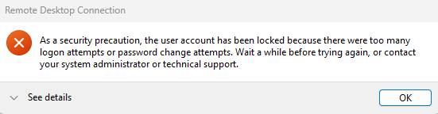

### 21. Unlock the Account and Reset the Password

After triggering the account lockout, I returned to `DC-1` and opened Active Directory Users and Computers.

I located the affected employee account and performed the following administrative tasks:

1. Opened the user's account properties.
2. Reset the account password.
3. Selected the option to unlock the user's account.
4. Applied the changes.
5. Verified that the user could sign in successfully.

**Purpose:** Unlocking accounts and resetting passwords are common help desk responsibilities. This exercise demonstrates how administrators restore access after account authentication issues.

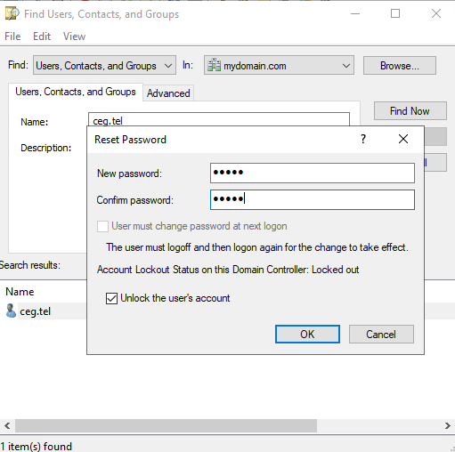

### 22. Disable an Active Directory User Account

I selected the same employee account in Active Directory Users and Computers and disabled it.

Disabling an account prevents it from being used for new domain authentication while preserving the account object and its existing configuration.

**Purpose:** Account disabling is an important identity management task used when employees leave an organization, change roles, or temporarily lose access.


### 23. Verify Login Failure for the Disabled Account

After disabling the account, I returned to `Client-1` and attempted to sign in using the disabled user's credentials.

Windows displayed an authentication error, confirming that the disabled account could no longer sign in.

**Purpose:** Testing the login restriction verifies that the account status change was enforced.


### 24. Re-Enable the Account and Restore Access

I returned to Active Directory Users and Computers and re-enabled the employee account.

I then attempted to sign in to `Client-1` using the account credentials.

The login was successful, confirming that access had been restored.

**Purpose:** This exercise demonstrates the account lifecycle management process and how administrators can restore access after an account has been disabled.


### 25. Investigate Failed Logon Attempts with Windows Event Viewer

For the final troubleshooting exercise, I signed in to `Client-1` using the domain administrator account and opened Windows Event Viewer.

I accessed Event Viewer using:

```powershell
eventvwr.msc
```

I reviewed Windows event logs and identified failed authentication attempts associated with the earlier login troubleshooting exercises.

Windows security logs provide valuable information for diagnosing authentication issues and investigating suspicious activity.

**Purpose:** Event log analysis helps IT support and security teams investigate failed logins, identify authentication problems, and understand user activity.

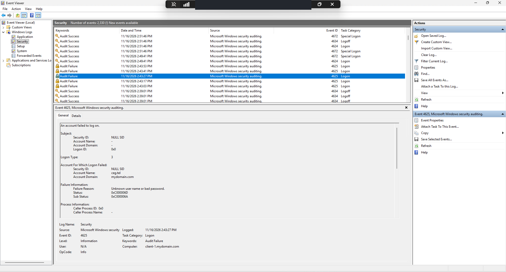

---

## Troubleshooting Scenarios Completed

Throughout this lab, I practiced several common IT support scenarios:

| Scenario | Troubleshooting Action |
|---|---|
| Domain connectivity | Tested communication between the client and domain controller using ping |
| DNS configuration | Verified the client's configured DNS server using `ipconfig /all` |
| Domain authentication | Joined a Windows 11 workstation to Active Directory and tested user sign-in |
| User provisioning | Automated employee account creation using PowerShell |
| Locked user account | Reset the password, unlocked the account, and verified access |
| Disabled user account | Confirmed login denial, re-enabled the account, and restored access |
| Failed authentication | Reviewed Windows event logs to investigate failed login attempts |

## Security Considerations

This project was completed in an isolated Microsoft Azure lab environment for educational purposes.

Several configurations were used to simplify testing and should be hardened before implementing a similar environment in production:

- Restrict Remote Desktop access to authorized users and administrators.
- Apply least-privilege principles to privileged accounts and security groups.
- Keep Windows Defender Firewall enabled with appropriate rules.
- Restrict inbound access through Azure Network Security Groups.
- Avoid exposing domain controllers directly to the public internet.
- Use strong, unique passwords and secure credential management.
- Apply account lockout policies based on organizational security requirements.
- Review Windows security logs regularly.
- Remove or deallocate unused Azure lab resources to reduce costs and exposure.

## Project Outcomes

By completing this lab, I gained practical experience with Microsoft Azure, Windows Server, Active Directory, PowerShell, and Windows security administration.

I successfully deployed a domain environment, configured a domain-joined workstation, provisioned employee accounts, managed access permissions, implemented account lockout settings, and troubleshot authentication issues.

The project demonstrates foundational skills relevant to IT Support, Help Desk, Desktop Support, Junior Systems Administration, and Identity and Access Management roles.

## Conclusion

This Active Directory lab strengthened my understanding of how organizations manage user identities, computers, authentication, and security policies in a Windows domain environment.

It also provided hands-on practice with real-world IT support responsibilities, including account provisioning, password resets, account lockouts, access restoration, and security event log analysis.

The experience provides a foundation for further learning in Windows administration, Microsoft Azure, and cloud security.


