# Azure Active Directory Lab
### Windows Server Administration | Azure Infrastructure | PowerShell Automation | IT Support & Security

## Project Overview

This project documents the deployment and administration of a Windows Active Directory environment hosted in Microsoft Azure. I built a functional domain environment using Windows Server 2022 and Windows 11 Pro to practice the infrastructure, identity management, automation, and troubleshooting responsibilities commonly performed by IT support technicians and systems administrators.

The environment consists of a Windows Server domain controller (`DC-1`) and a domain-joined Windows 11 workstation (`Client-1`). Throughout the lab, I configured Azure networking and DNS, installed Active Directory Domain Services, provisioned user accounts, automated employee creation with PowerShell, configured Group Policy account lockout settings, and investigated authentication failures through Windows Event Viewer.

The project focuses on practical IT administration skills, including restoring employee access, troubleshooting login problems, managing account permissions, and understanding how Windows domain infrastructure supports business operations.

## Key Accomplishments

- Deployed a Windows Server 2022 domain controller and Windows 11 workstation in Microsoft Azure.
- Configured a static private IP address, client DNS settings, and network connectivity.
- Installed Active Directory Domain Services and created the `mydomain.com` domain.
- Joined a Windows 11 workstation to the Active Directory domain.
- Created organizational units, administrator accounts, and security group memberships.
- Automated employee account provisioning using Windows PowerShell.
- Configured and tested account lockout settings through Group Policy.
- Practiced password resets, account unlocking, account disabling, and access restoration.
- Investigated failed authentication attempts using Windows Event Viewer.
- Documented the environment and troubleshooting procedures with 25 lab screenshots.

## Table of Contents

- [Project Overview](#project-overview)
- [Key Accomplishments](#key-accomplishments)
- [Technologies Used](#technologies-used)
- [Lab Objectives](#lab-objectives)
- [Network Architecture](#network-architecture)
- [Lab Environment](#lab-environment)
- [Project Phases](#project-phases)
- [Phase 1 — Azure Infrastructure & Active Directory Deployment](#phase-1--azure-infrastructure--active-directory-deployment)
- [Phase 2 — Active Directory User Administration & PowerShell Automation](#phase-2--active-directory-user-administration--powershell-automation)
- [Phase 3 — Account Security, Troubleshooting & Event Monitoring](#phase-3--account-security-troubleshooting--event-monitoring)
- [Troubleshooting Scenarios Completed](#troubleshooting-scenarios-completed)
- [Skills Demonstrated](#skills-demonstrated)
- [Security Considerations](#security-considerations)
- [Project Outcomes](#project-outcomes)
- [Conclusion](#conclusion)

---

## Technologies Used

| Technology | Purpose |
|---|---|
| Microsoft Azure | Hosting virtual machines and networking resources |
| Windows Server 2022 | Domain controller operating system |
| Windows 11 Pro | Domain-joined client workstation |
| Active Directory Domain Services | Centralized identity and domain management |
| Active Directory Users and Computers | Managing users, computers, and groups |
| DNS | Domain name resolution and domain controller discovery |
| Group Policy Management Console | Configuring domain security policies |
| Windows PowerShell ISE | Automating employee account creation |
| Windows Event Viewer | Investigating authentication events |
| Remote Desktop Protocol | Remote administration and workstation access |

## Lab Objectives

1. Deploy and configure Windows Server and Windows 11 virtual machines in Azure.
2. Establish network connectivity and configure DNS for Active Directory.
3. Install Active Directory Domain Services and create a Windows domain.
4. Join a Windows 11 workstation to the domain.
5. Create and manage organizational units, users, computers, and security groups.
6. Automate domain user provisioning with PowerShell.
7. Configure and test account lockout policies.
8. Troubleshoot locked and disabled user accounts.
9. Investigate failed authentication attempts using Windows security logs.
10. Document the environment and demonstrate practical IT support skills.

---

## Network Architecture

The lab uses an Azure virtual network to connect a Windows Server domain controller and a Windows 11 client workstation.

The domain controller provides Active Directory authentication and DNS services. The Windows 11 workstation uses the domain controller's private IP address for DNS resolution and communicates with it to access domain services.

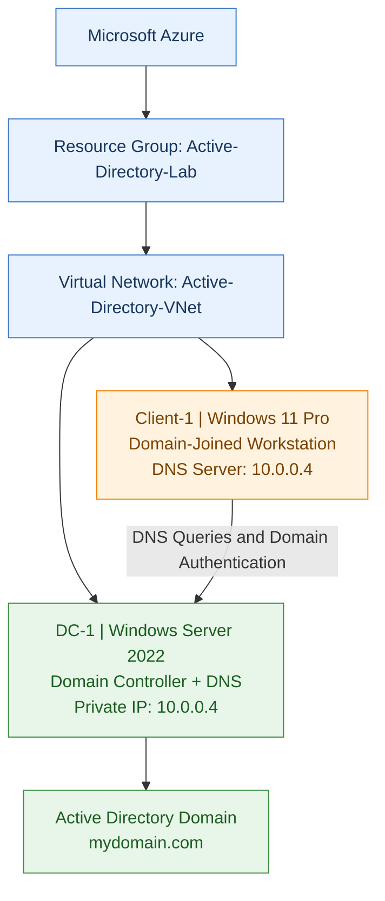

**Architecture Summary:**

- **DC-1:** Windows Server 2022 virtual machine running Active Directory Domain Services and DNS.
- **Client-1:** Windows 11 Pro workstation joined to `mydomain.com`.
- **Private Networking:** Both virtual machines communicate over `Active-Directory-VNet`.
- **DNS Configuration:** Client-1 uses DC-1's private IP address, `10.0.0.4`, for DNS.
- **Centralized Authentication:** Domain users authenticate against Active Directory.

The diagram illustrates the logical lab environment rather than a production-ready network security design.

## Lab Environment

| Component | Configuration |
|---|---|
| Cloud Platform | Microsoft Azure |
| Resource Group | Active-Directory-Lab |
| Virtual Network | Active-Directory-VNet |
| Domain Controller | DC-1 |
| Domain Controller OS | Windows Server 2022 |
| Domain Controller Private IP | 10.0.0.4 (Static) |
| Client Workstation | Client-1 |
| Client OS | Windows 11 Pro |
| Active Directory Domain | mydomain.com |
| Employee Organizational Unit | _EMPLOYEES |
| Administrator Organizational Unit | _ADMINS |
| Administrative Test Account | jane_admin |

## Project Phases

### Phase 1 — Azure Infrastructure & Active Directory Deployment

Deploy the Azure resource group, virtual network, and virtual machines. Configure the domain controller's static private IP address, client DNS settings, and network connectivity. Install Active Directory Domain Services and promote Windows Server to a domain controller.

### Phase 2 — Active Directory User Administration & PowerShell Automation

Create organizational units and administrative accounts, configure security group membership, join the Windows 11 workstation to the domain, manage Remote Desktop permissions, and automate employee account creation using PowerShell.

### Phase 3 — Account Security, Troubleshooting & Event Monitoring

Configure account lockout settings through Group Policy, simulate failed authentication attempts, unlock and reset user accounts, disable and re-enable accounts, and investigate authentication failures through Windows Event Viewer.

---

## Phase 1 — Azure Infrastructure & Active Directory Deployment

### 1. Create the Azure Resource Group

I began by creating a resource group named `Active-Directory-Lab` in Microsoft Azure.

The resource group provided a centralized location for organizing and managing the infrastructure required for the Active Directory environment.

**Purpose:** Azure resource groups allow administrators to organize related resources and manage their lifecycle.

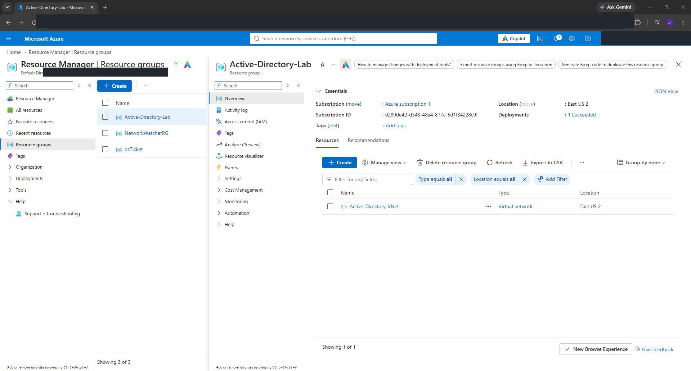

### 2. Configure the Virtual Network

I created an Azure virtual network named `Active-Directory-VNet` to provide network connectivity between the domain controller and the Windows 11 client workstation.

Both virtual machines were deployed within the same virtual network to support communication required for domain authentication, DNS resolution, and Active Directory management.

**Purpose:** A properly configured virtual network allows domain-joined computers to communicate with the domain controller.

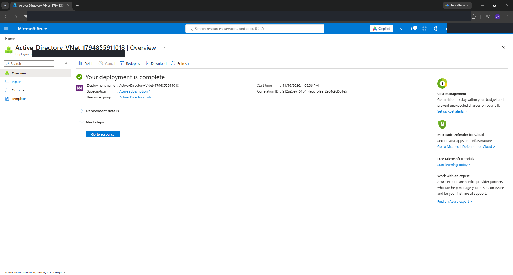

### 3. Deploy the Domain Controller

I deployed a Windows Server 2022 virtual machine named `DC-1` to serve as the domain controller for the Active Directory environment.

The server was configured within the existing resource group and virtual network.

**Purpose:** The domain controller provides centralized authentication, identity management, and domain services for the environment.


### 4. Deploy the Windows 11 Client

I deployed a Windows 11 Pro virtual machine named `Client-1` in the same Azure resource group and virtual network as `DC-1`.

This workstation was used to test domain connectivity, user authentication, account management, and troubleshooting scenarios.

**Purpose:** The client workstation simulates an employee computer within an enterprise Active Directory environment.

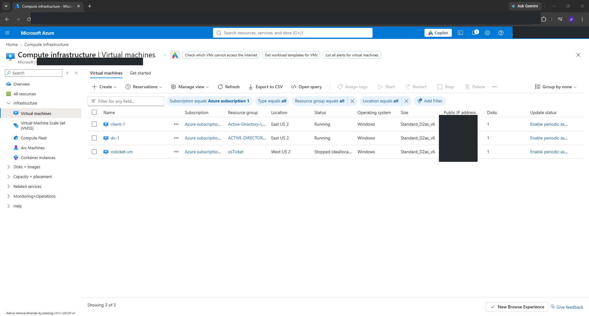

### 5. Configure the Domain Controller's Private IP Address

I configured the network interface associated with `DC-1` to use a static private IP address of `10.0.0.4`.

**Purpose:** Assigning a static private IP ensures that the domain controller maintains a consistent network address for DNS resolution and domain authentication.


### 6. Configure Client DNS Settings

After configuring the domain controller's static private IP address, I updated the DNS settings for the Windows 11 client workstation.

I configured `Client-1` to use the private IP address of `DC-1` (`10.0.0.4`) as its DNS server.

**Purpose:** Active Directory relies on DNS to locate domain controllers and other domain services. Pointing the client to the domain controller allows it to resolve the Active Directory domain.


### 7. Test Network Connectivity

I connected to `Client-1` using Remote Desktop and opened PowerShell.

I used the `ping` command to test communication with the domain controller:

```powershell
ping 10.0.0.4
```

The test confirmed that the client workstation could communicate with the domain controller over the Azure virtual network.

**Purpose:** Testing network connectivity helps identify potential communication issues before attempting to join a workstation to a domain.


### 8. Verify DNS Configuration

I ran the following command on `Client-1`:

```powershell
ipconfig /all
```

I verified that the DNS server listed in the network configuration matched the private IP address of `DC-1`.

**Purpose:** Verifying DNS settings helps ensure the workstation can locate the domain controller for domain authentication.

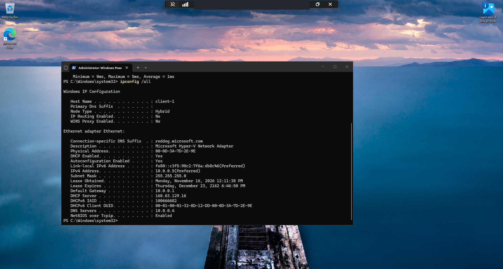

### 9. Install Active Directory Domain Services

I connected to `DC-1` and installed the Active Directory Domain Services (AD DS) server role using Windows Server Manager.

AD DS provides centralized identity management, authentication, and authorization for computers and users in a Windows domain environment.

**Purpose:** Installing AD DS prepares the Windows Server virtual machine to function as a domain controller.

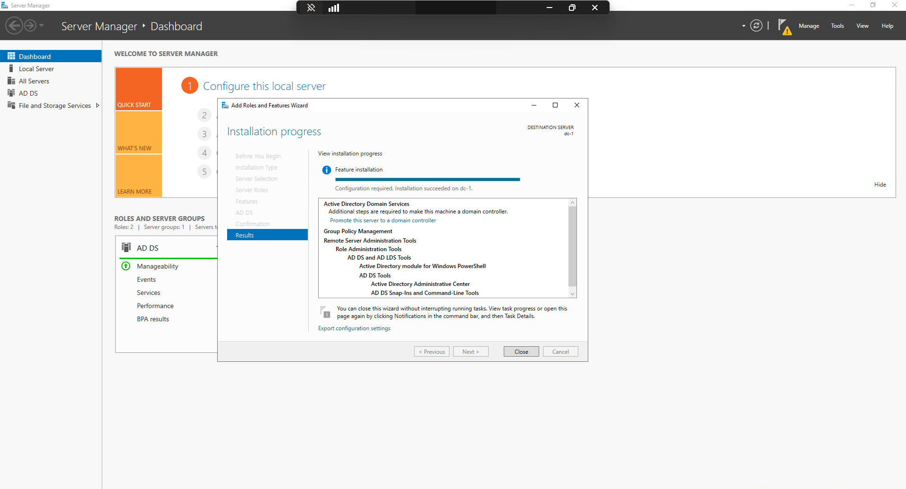

### 10. Promote the Server to a Domain Controller

After installing AD DS, I promoted `DC-1` to a domain controller.

I created a new Active Directory forest with the domain name:

`mydomain.com`

After completing the configuration and restarting the server, the domain controller was ready to manage domain users, computers, and security policies.

**Purpose:** Promoting the server establishes the Active Directory domain and enables centralized management of domain resources.

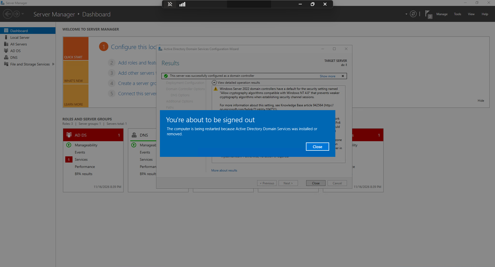

---

## Phase 2 — Active Directory User Administration & PowerShell Automation

### 11. Create Organizational Units

Using Active Directory Users and Computers (ADUC), I created two organizational units:

- `_EMPLOYEES` — For standard employee accounts.
- `_ADMINS` — For administrative accounts.

Organizational units provide a structured way to organize and manage Active Directory objects.

**Purpose:** Separating employee and administrator accounts helps maintain an organized directory and supports administrative delegation and policy management.


### 12. Create a Domain Administrator Account

I created a user account named `jane_admin` for Jane Doe and placed it in the `_ADMINS` organizational unit.

I added the account to the `Domain Admins` security group.

After configuring the account, I signed out of `DC-1` and signed back in using the domain administrator credentials.

**Purpose:** This exercise demonstrates user account creation, security group membership management, and privileged domain administration.

**Security Note:** Domain Admins membership provides extensive privileges and should be restricted to authorized administrators. In production environments, administrators should use least-privilege access and separate privileged accounts from everyday user accounts.


### 13. Join Windows 11 to the Active Directory Domain

I connected to `Client-1` using the local administrator account and joined the workstation to:

`mydomain.com`

After entering authorized domain credentials, I restarted the workstation to complete the domain join.

**Purpose:** Domain joining allows a workstation to authenticate users through Active Directory and participate in centralized domain management.


### 14. Verify the Computer in Active Directory

After joining `Client-1` to the domain, I returned to `DC-1` and opened Active Directory Users and Computers.

I verified that the client workstation appeared as a computer object in the domain.

**Purpose:** Verifying the computer object confirms that the workstation has successfully joined the Active Directory environment.


### 15. Configure Remote Desktop Access for Domain Users

I signed in to `Client-1` using the domain administrator account and configured Remote Desktop access.

For the lab, I added the `Domain Users` group to the workstation's Remote Desktop access permissions.

This allowed me to test authentication using standard domain user accounts.

**Purpose:** This exercise demonstrates how Windows administrators configure and troubleshoot remote access permissions for domain users.

**Security Note:** Granting Remote Desktop access to all domain users was performed for testing purposes. In production environments, access should be limited to explicitly authorized users or security groups.


### 16. Automate Active Directory User Creation with PowerShell

To practice account provisioning and administrative automation, I used Windows PowerShell ISE on `DC-1`.

I executed a PowerShell script that generated employee user accounts in Active Directory.

The script created accounts within the `_EMPLOYEES` organizational unit.

**Purpose:** PowerShell automation can reduce repetitive administrative work, improve consistency, and support large-scale user provisioning.

**Script Reference:**
[Josh Madakor — Active Directory PowerShell User Creation Script](https://github.com/joshmadakor1/AD_PS/blob/master/Generate-Names-Create-Users.ps1)

**Security Note:** The script was used in an isolated lab environment. Example passwords and credentials should never be reused in production or included in public repositories.

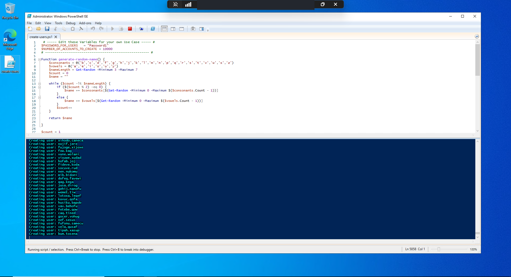

### 17. Verify Bulk-Created Employee Accounts

After executing the PowerShell script, I opened Active Directory Users and Computers.

I navigated to `_EMPLOYEES` and verified that the generated employee accounts were present.

**Purpose:** This verification demonstrates successful automated user provisioning and confirms that the accounts were created in the intended organizational unit.

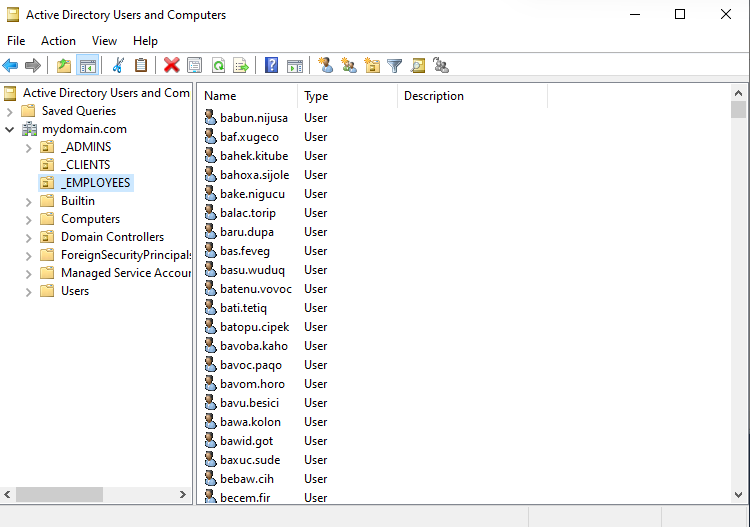

### 18. Test Domain User Authentication

I selected one of the employee accounts created through PowerShell and attempted to sign in to `Client-1`.

The login was successful, confirming that the account could authenticate against the Active Directory domain.

**Purpose:** Testing domain authentication verifies that the newly provisioned accounts are functional and can access an authorized domain-joined workstation.

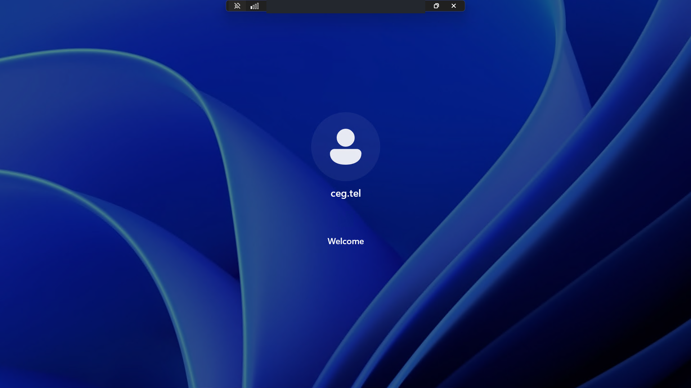

---

## Phase 3 — Account Security, Troubleshooting & Event Monitoring

### 19. Configure Account Lockout Policy Using Group Policy

I opened the Group Policy Management Console (GPMC) and configured account lockout settings for the Active Directory environment.

The lab used the following settings:

| Policy Setting | Configured Value |
|---|---|
| Account lockout threshold | 5 invalid logon attempts |
| Account lockout duration | 30 minutes |
| Reset account lockout counter after | 10 minutes |

These settings were used to simulate an organization's password security controls.

**Purpose:** Account lockout policies help protect user accounts against repeated unauthorized password attempts.

**Technical Note:** Domain account lockout settings must be configured in an effective domain-level password policy to apply correctly to domain accounts. Organizational unit policies alone do not establish the domain-wide account lockout policy.


### 20. Simulate a Domain User Account Lockout

To test the account lockout policy, I attempted to sign in to `Client-1` using an employee account with an incorrect password multiple times.

After reaching the configured threshold of five failed login attempts, the account became locked.

I observed the Windows authentication error message indicating that the account could not be used to sign in.

**Purpose:** This exercise demonstrates how account lockout policies respond to repeated failed authentication attempts.


### 21. Unlock the Account and Reset the Password

After triggering the account lockout, I returned to `DC-1` and opened Active Directory Users and Computers.

I located the affected employee account and performed the following administrative tasks:

1. Opened the user's account properties.
2. Reset the account password.
3. Selected the option to unlock the user's account.
4. Applied the changes.
5. Verified that the user could sign in successfully.

**Purpose:** Unlocking accounts and resetting passwords are common help desk responsibilities. This exercise demonstrates how administrators restore access after account authentication issues.


### 22. Disable an Active Directory User Account

I selected the same employee account in Active Directory Users and Computers and disabled it.

Disabling an account prevents it from being used for new domain authentication while preserving the account object and its existing configuration.

**Purpose:** Account disabling is an important identity management task used when employees leave an organization, change roles, or temporarily lose access.

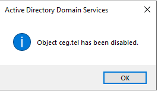

### 23. Verify Login Failure for the Disabled Account

After disabling the account, I returned to `Client-1` and attempted to sign in using the disabled user's credentials.

Windows displayed an authentication error, confirming that the disabled account could no longer sign in.

**Purpose:** Testing the login restriction verifies that the account status change was enforced.

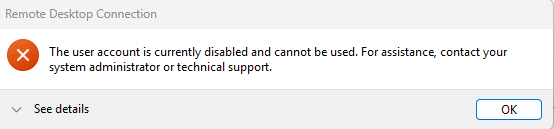

### 24. Re-Enable the Account and Restore Access

I returned to Active Directory Users and Computers and re-enabled the employee account.

I then attempted to sign in to `Client-1` using the account credentials.

The login was successful, confirming that access had been restored.

**Purpose:** This exercise demonstrates the account lifecycle management process and how administrators can restore access after an account has been disabled.

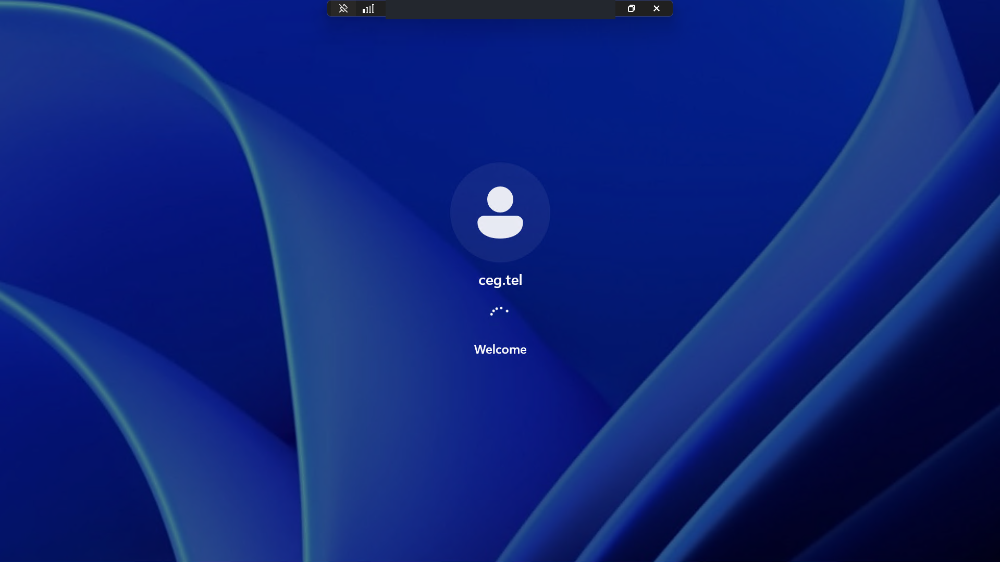

### 25. Investigate Failed Logon Attempts with Windows Event Viewer

For the final troubleshooting exercise, I signed in to `Client-1` using the domain administrator account and opened Windows Event Viewer.

I accessed Event Viewer using:

```powershell
eventvwr.msc
```

I reviewed Windows event logs and identified failed authentication attempts associated with the earlier login troubleshooting exercises.

Windows security logs provide valuable information for diagnosing authentication issues and investigating suspicious activity.

**Purpose:** Event log analysis helps IT support and security teams investigate failed logins, identify authentication problems, and understand user activity.

**Technical Note:** Windows Security Event ID `4625` represents a failed logon. Event ID `4740` represents a user account lockout and is typically investigated on a domain controller. These event IDs are useful references for future troubleshooting.


---

## Troubleshooting Scenarios Completed

Throughout this lab, I practiced several common IT support scenarios:

| Scenario | Troubleshooting Action | Result |
|---|---|---|
| Network connectivity | Tested communication using `ping` | Verified client-to-server connectivity |
| DNS configuration | Inspected settings using `ipconfig /all` | Confirmed the configured DNS server |
| Domain authentication | Joined Client-1 to Active Directory | Verified domain membership |
| User provisioning | Executed a PowerShell user creation script | Created and verified employee accounts |
| Locked user account | Reset password and unlocked account | Restored user access |
| Disabled user account | Disabled account and attempted login | Confirmed authentication was blocked |
| Account reactivation | Re-enabled account and tested login | Restored authentication |
| Failed authentication | Reviewed Windows event logs | Identified failed login activity |

## Skills Demonstrated

### Cloud Infrastructure & Networking

- Microsoft Azure virtual machine deployment
- Azure resource group and virtual network configuration
- Static private IP configuration
- DNS configuration and troubleshooting
- Client-to-server network connectivity testing
- Remote Desktop administration

### Windows Server & Active Directory

- Windows Server 2022 administration
- Active Directory Domain Services deployment
- Domain controller configuration
- Organizational unit management
- Domain user and computer administration
- Security group membership management
- Windows workstation domain joining

### PowerShell & Automation

- Windows PowerShell ISE
- Automated employee account provisioning
- Script execution and administrative automation
- Verification of automatically created directory objects

### IT Support & Security Troubleshooting

- User account creation and management
- Password resets
- Account unlocking
- Account disabling and re-enabling
- Remote Desktop access troubleshooting
- Group Policy account lockout configuration
- Windows Event Viewer analysis
- Authentication troubleshooting
- Technical documentation

---

## Project Outcomes

By completing this lab, I gained practical experience with Microsoft Azure, Windows Server, Active Directory, PowerShell, and Windows security administration.

I successfully:

- Deployed and configured a Windows domain environment in Azure.
- Established communication between a domain controller and client workstation.
- Configured DNS and verified network connectivity.
- Created and managed Active Directory users, computers, and organizational units.
- Automated employee account provisioning using PowerShell.
- Configured account lockout settings and tested authentication behavior.
- Troubleshot locked and disabled user accounts.
- Restored access through password resets, unlocking, and account re-enablement.
- Investigated failed login activity using Windows Event Viewer.

This project demonstrates foundational skills relevant to:

- IT Support Specialist
- Help Desk Technician
- Desktop Support Technician
- Junior Systems Administrator
- Active Directory Support Technician
- Identity and Access Management Support

## Conclusion

This Azure Active Directory lab strengthened my understanding of how organizations manage identities, computers, authentication, and security policies within Windows domain environments.

The project provided hands-on practice with real-world IT support responsibilities, including account provisioning, password resets, account lockouts, access restoration, DNS troubleshooting, and security event log analysis.

By combining Azure infrastructure, Windows Server administration, PowerShell automation, and Active Directory troubleshooting, I developed a stronger foundation for pursuing IT support, systems administration, and cloud security roles.
